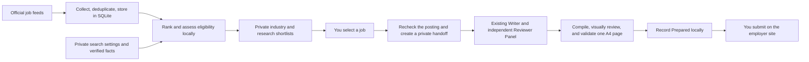

# Job Scout

Find jobs, see why they fit your verified experience, and hand a selected role to your existing résumé workflow. **Job Scout runs on demand and keeps search settings, rankings, and application files on your machine.**

[Quick start](#quick-start) · [Architecture](#architecture) · [Agents and skills](#agents-and-skills) · [Privacy](#privacy-and-storage)

## What works today

- Collect public postings from Greenhouse, Lever, and the University of Bath’s research feed.
- Rank industry and research roles separately. See the posting text, evidence behind each match, gaps, and unresolved eligibility requirements.
- Select a job from the private report, verify it against the official feed, and hand it to an existing résumé Writer and independent Reviewer Panel.

## Quick start

Run these commands from the checkout with Python 3.12 or newer:

```sh
python -m pip install -r requirements.txt
python -m job_scout check-data-dir
python -m job_scout init-profiles
python -m job_scout check-profiles
```

1. **Set your search preferences.** Edit `search_preferences.yaml` in your private data folder. The [fictional example](examples/search-preferences.example.yaml) shows Industry and Research profiles with regions, title aliases, sponsorship, funding, and freshness filters. Add `--candidate-facts "/absolute/path/to/candidate_facts.yaml"` to `init-profiles` if you want title suggestions from your verified experience. Initialization preserves an existing profile.
2. **Create your watchlist.** Copy the [example watchlist](examples/job-sources.example.yaml) to `job_sources.yaml` in the private data folder. Replace the fictional employer IDs with real board IDs.
3. **Collect and rank.** Run the commands below, then open `ranked_jobs.html` from your private data folder. Replace the example path with your verified facts file. You can omit `--candidate-facts` if that file is already named `candidate_facts.yaml` in private storage.

```sh
python -m job_scout collect-jobs
python -m job_scout rank-jobs --candidate-facts "/absolute/path/to/candidate_facts.yaml"
```

The default private folder is `%LOCALAPPDATA%\JobScout` on Windows and `~/.local/share/job-scout` elsewhere. Set `JOB_SCOUT_DATA_DIR` or pass `--data-dir` to use a different absolute path outside the checkout.

### Supported sources

| Provider | Watchlist setting |
| --- | --- |
| [Greenhouse](https://docs.greenhouse.io/job-board.html) | Use the employer’s board token. |
| [Lever](https://github.com/lever/postings-api) | Use the site name. Set `instance: eu` for boards on `jobs.eu.lever.co`. |
| [University of Bath](https://www.bath.ac.uk/jobs/rss/) | Use `provider: bath` and `board: research` for the Education & Research feed. |

The watchlist controls which feeds are checked. Collection records each source’s status separately, so a failed request is distinguishable from a feed with zero postings. Duplicate sightings update the local job record and preserve when it was first seen.

## Architecture



The Python commands handle collection, ranking, and local handoff checks. The résumé writing and independent review start separately in your existing workflow after you select a job.

### How ranking works

The fit score compares recognized technical criteria in the posting with verified candidate evidence. Required criteria carry three points, responsibilities two, and preferred criteria one. Direct evidence earns full credit, verified role technologies earn 60%, transferable experience earns 35%, and unsupported criteria earn zero. A job needs a fit score of at least 50, a recent sighting in its source feed, two recognized criteria, and one direct match to qualify for the shortlist. Each profile shows up to ten shortlisted jobs.

Search profiles use `required`, `preferred`, and `excluded` filters. Values within one required filter are alternatives. Required filters across fields apply together. Preferences help order results. For remote roles, `remote_regions` records where you need to be allowed to work.

Eligibility is shown separately as **met**, **unmet**, or **unknown**. Unstated sponsorship stays unknown. Open a role to see the evidence IDs, source excerpts, and checks for deadlines, funding, degrees, and language where applicable. The HTML report also retains other reviewed roles, including those outside your preferences.

## Agents and skills

Agents describe who does the work. Skills define the workflow and what evidence to return. These definitions support interactive Codex sessions. The Python commands above run without launching them.

| Agent | Skill | Responsibility |
| --- | --- | --- |
| [`industry_scout`](.codex/agents/industry-scout.toml) | [`discover-jobs`](.agents/skills/discover-jobs/SKILL.md) | Finds public industry postings using the supplied titles, aliases, locations, and filters. |
| [`research_scout`](.codex/agents/research-scout.toml) | [`discover-jobs`](.agents/skills/discover-jobs/SKILL.md) | Finds research and PhD postings and records stated deadlines, degree requirements, and funding. |
| [`evidence_matcher`](.codex/agents/evidence-matcher.toml) | [`score-jobs`](.agents/skills/score-jobs/SKILL.md) | Connects posting requirements to supplied evidence IDs and flags gaps and eligibility unknowns. |
| Existing private application team | [`prepare-selected-job`](.agents/skills/prepare-selected-job/SKILL.md) → `job-application-tailor` | Rechecks the selected posting and hands it to the existing Orchestrator, Researcher/Matcher, Writer, and independent four-lens Reviewer Panel. The local scripts enforce the PDF gates. |

The private application engine owns the résumé template, evidence rules, and review process. The public repo provides the handoff and fictional examples.

## Prepare a selected job

1. Copy the [example engine setting](examples/tailor-engine.example.yaml) to `tailor_engine.yaml` in private storage. Set `root` to your existing, trusted application workspace. It needs the `job-application-tailor` skill, its résumé-only validator, a verified facts file, and a master LaTeX résumé.
2. Run `python -m job_scout check-tailor`. Pick an ID from the private report and run `python -m job_scout select-job JOB_ID`. Job Scout verifies the official listing before creating a private application folder.
3. Open the generated `START_HERE.md` and start the existing Writer and Reviewer workflow. Use a local model runtime if résumé drafting and review must stay on-device. The handoff itself runs no model.
4. Follow the `tailor-stage` commands in the handoff. They freeze the review snapshot, require an independent PASS before compilation, and validate the PDF after visual review. Only a verified one-page A4 résumé is marked **Prepared** in private tracking.

Selecting an unchanged posting reuses its handoff. A revised posting gets its own version. You submit applications yourself.

## Privacy and storage

| Location | Contents |
| --- | --- |
| **Public checkout** | Python code, Codex roles, workflow instructions, and fictional examples and tests. |
| **Private data folder** | Search preferences, watchlist, engine settings, SQLite database, ranking reports, application workspaces, PDFs, and tracking. |
| **Existing private application workspace** | Candidate facts, master LaTeX résumé, and the original writing, review, and validation workflow. |

Collection and selected-job checks use public source endpoints. Ranking reads local files. Job Scout rejects private storage paths inside the public checkout, including symlinks into it. Generated applications and tracking stay outside both Git checkouts.

## Test and contribute

Run `python -m unittest discover -s tests -v` after installing dependencies. The tests use fictional data and cover source parsing, deduplication, evidence matching, eligibility, and the private handoff. See [repository instructions](AGENTS.md), the [MIT license](LICENSE), and [private security reporting](SECURITY.md).

**Next milestone:** local scheduling, daily shortlists, and alerts for new strong matches.
